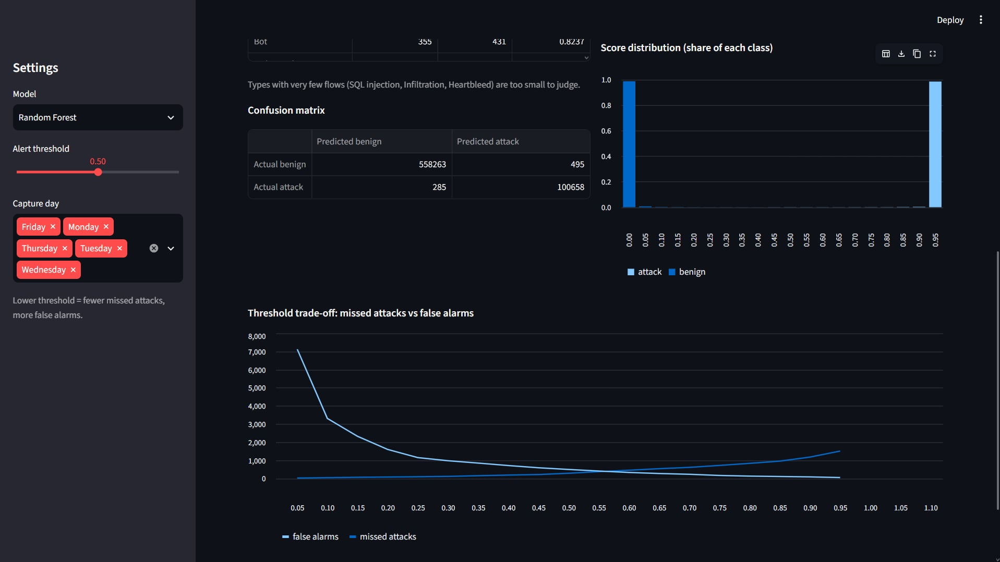
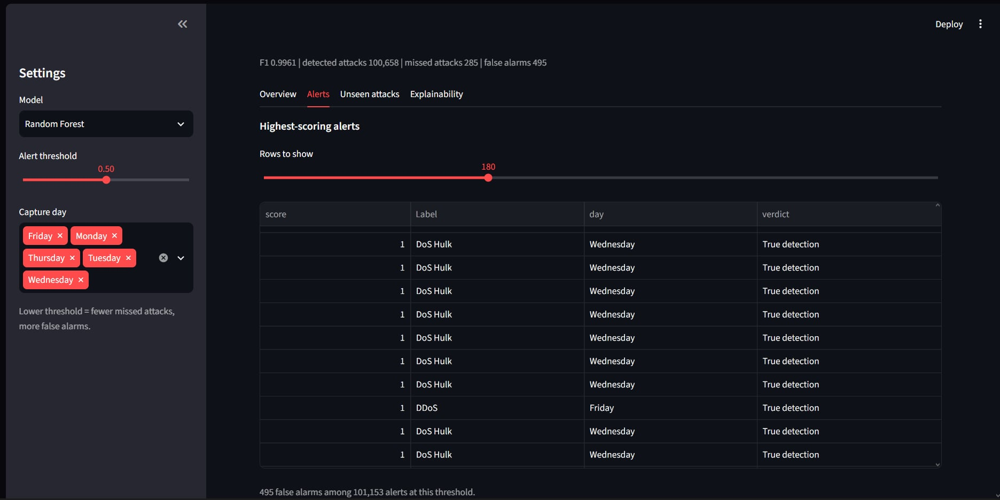
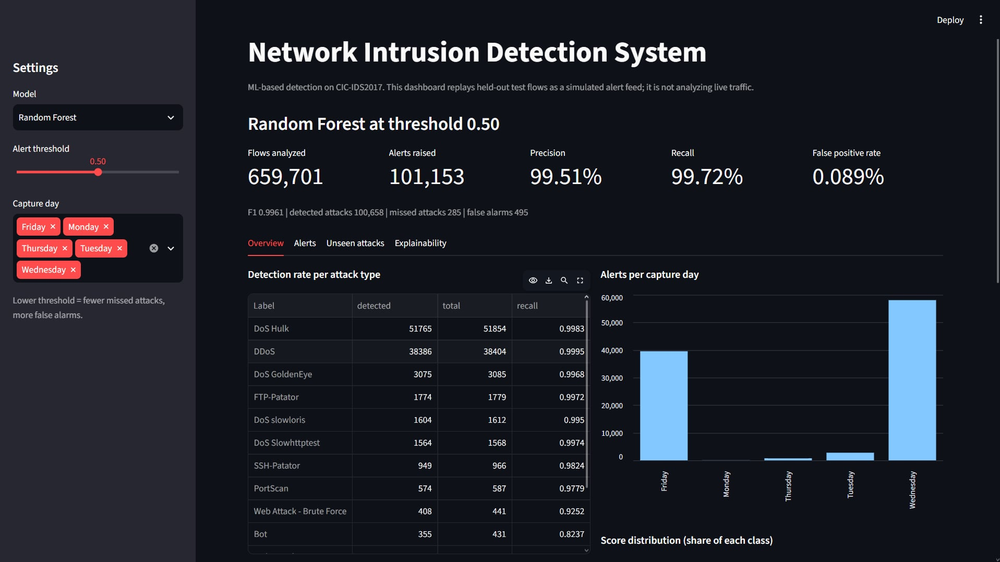
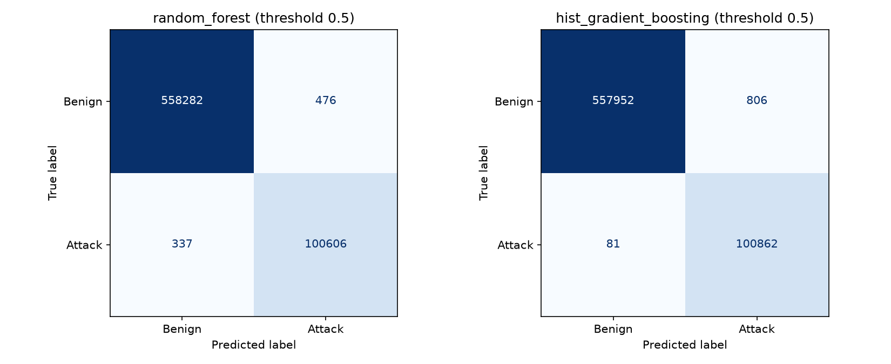

# Network Intrusion Detection System (ML)

Machine-learning NIDS trained on the CIC-IDS2017 dataset, with an interactive Streamlit dashboard for exploring detections, false alarms, and the effect of the alert threshold.

> The dashboard replays held-out test flows as a simulated alert feed. It does **not** analyze live traffic.


## Dashboard






## What it does

- Cleans and deduplicates CIC-IDS2017 flow records.
- Trains and compares two models: Random Forest and Histogram Gradient Boosting.
- Evaluates with precision, recall, F1, false positive rate, ROC/PR AUC, per-attack detection rates and confusion matrices.
- Analyzes the precision/recall trade-off across alert thresholds.
- Tests how the models behave on attack families they have never seen.
- Explains which features drive the model (permutation importance).
- Presents everything in a dashboard with a threshold slider.

## Dataset

[CIC-IDS2017](https://www.unb.ca/cic/datasets/ids-2017.html) from the Canadian Institute for Cybersecurity (Sharafaldin, Lashkari, Ghorbani, ICISSP 2018). I used the cleaned Parquet version published on Kaggle (`dhoogla/cicids2017`), which has no IP addresses, ports or timestamps.

| Step | Result |
|---|---|
| Raw flows (8 files) | 2,313,810 |
| Duplicates removed across files | 114,808 |
| Flows used | 2,199,002 (15.3% attacks) |
| Features | 77, of which 8 are constant and dropped (69 used) |

Attack classes are heavily imbalanced: Heartbleed (11 flows), Infiltration (36) and SQL injection (21) are too small to evaluate reliably.

## Methodology

1. `src/data_loader.py`: load, normalize labels (a corrupted dash in the web-attack labels is fixed), cast to float32, deduplicate globally, cache to Parquet.
2. `src/preprocess.py`: drop constant features; 70/30 split stratified on the full attack label, then the training part is split again 75/25 (52.5% train, 17.5% validation, 30% test).
3. `src/train.py`: binary detection (benign vs attack) with Random Forest (100 trees, depth 20) and HistGradientBoosting (200 iterations), both class-weighted.
4. `src/analyze.py`: threshold sweep, PR curves, confusion matrices; alert thresholds are chosen on the validation set and saved to `models/thresholds.json`.
5. `src/unseen_attacks.py`: hold out one attack family at a time and compare the supervised Random Forest with an Isolation Forest trained only on benign traffic.
6. `src/explain.py`: permutation importance on 30,000 test flows.

## Results

### Binary detection (stratified split, threshold 0.5)

| | Random Forest | Hist Gradient Boosting |
|---|---|---|
| Precision | 99.53% | 99.21% |
| Recall | 99.67% | 99.92% |
| False positive rate | 0.09% | 0.14% |
| Missed attacks | 337 | 81 |
| False alarms | 476 | 806 |

The threshold matters more than the model. I chose each threshold on a separate validation split to stay within a 0.1% false-alarm budget (Random Forest 0.474, HistGradientBoosting 0.715), then evaluated it once on the untouched test set. Random Forest catches 99.70% of attacks (299 missed, 535 false alarms) and HistGradientBoosting 99.81% (187 missed, 536 false alarms). The false-alarm rate on the test set (0.096%) stayed within the budget for both models.



### Weakest attack types (Random Forest, threshold 0.5)

Bot 81.7%, Web Brute Force 93.0%. The very small classes (SQL injection 1 of 6, Infiltration 9 of 11, Heartbleed 3 of 3) are too small to draw conclusions from.

### Unseen attack families

Models trained without one attack family, then tested on it. AUC measures whether unseen attacks are ranked above benign traffic; recall is at a fixed threshold (Random Forest 0.5; Isolation Forest set to flag about 1% of benign training flows).

| Held-out family | Flows | RF AUC | RF recall | Isolation Forest AUC | Isolation Forest recall |
|---|---|---|---|---|---|
| DoS | 58,122 | 0.959 | 1.0% | 0.934 | 56.0% |
| DDoS | 38,404 | 0.975 | 63.4% | 0.809 | 13.5% |
| PortScan | 587 | 0.875 | 7.3% | 0.659 | 1.9% |
| Brute force (FTP/SSH) | 2,745 | 0.961 | 0.2% | 0.719 | 0.0% |
| Web attacks | 643 | 0.992 | 69.7% | 0.641 | 0.0% |
| Bot | 431 | 0.544 | 0.0% | 0.573 | 0.0% |

Takeaway: the supervised model ranks most unseen attacks above benign traffic but misses them at a fixed threshold, and the benign-only anomaly detector helps for some families (DoS) but is near random for others. Single run, lighter Random Forest (60 trees, benign capped at 300k flows); small families are noisy.

### Explainability

Features describing the server's replies (backward packet length, segment size, bytes) and initial TCP window sizes matter most. Many features are strongly correlated, so look at feature groups rather than exact ranks.


## Limitations

- CIC-IDS2017 is from 2017 and was generated in a controlled lab; the models are not expected to work as-is on real networks.
- The random split places similar flows from the same attack session in train and test, so the headline scores are an upper bound.
- Validation and test come from the same random split, so the threshold transfer shown here is optimistic for real traffic.
- Initial TCP window sizes may reflect lab machine configuration rather than attack behavior (not tested).
- Rare classes cannot be evaluated reliably.
- Detection is flow-based and offline; live packet capture is not implemented.

## Run it

Requires Python 3.12+ (developed on 3.14). The data and trained models are not stored in Git.

```powershell
python -m venv .venv
.\.venv\Scripts\python.exe -m pip install -r requirements.txt

# 1. Download the dataset (Kaggle: dhoogla/cicids2017) into data/raw/
# 2. Run the pipeline
.\.venv\Scripts\python.exe -m src.data_loader
.\.venv\Scripts\python.exe -m src.train
.\.venv\Scripts\python.exe -m src.analyze
.\.venv\Scripts\python.exe -m src.unseen_attacks
.\.venv\Scripts\python.exe -m src.explain

# 3. Launch the dashboard
.\.venv\Scripts\python.exe -m streamlit run app.py
```

## Possible next steps

- Multi-class classification by attack type.
- Cross-validation, ideally leave-one-day-out, to test generalization.
- Live capture with controlled test traffic.
- Drift monitoring and retraining.
